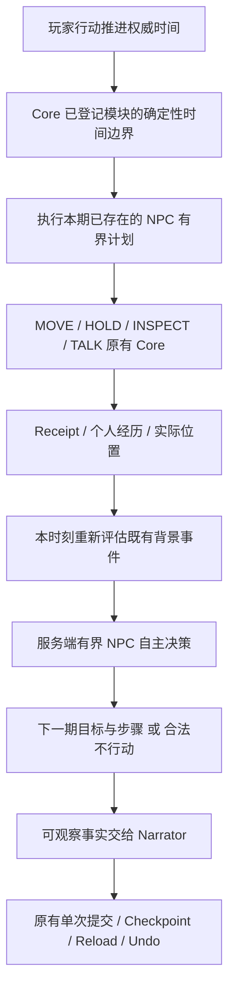

# NPC 自主世界与持续剧情：运行链修复及离线验收

日期：2026-10-18。状态：本轮代码与离线验收完成；未部署、未调用真实 Provider，不能宣布正式世界的自主生活表现已通过真人验收。

## 1. 正式取证（不剧透）

只读正式状态仍为 REV388，第1日17:28。SHA256：
`95527b7bc9fa7968e77d44843ee3e3217b347bdcd6530e2eda500dab61fea144`。

| 事务 | Trace | 实际证据 |
|---|---|---|
| REV385→386，厨房等待30分钟 | `tr_a79e71f7ac23`，request `b5590059-9909-4edf-8b82-0d3e74759873` | 正常提交 WAIT；两名 NPC 提交 INSPECT，没有 NPC MOVE |
| REV386→387，移动餐厅 | `tr_acca136d0ae1`，request `7d1abc6b-9399-47bb-b93b-37845103d8a5` | 玩家 MOVE 正常提交；NPC位置未变 |
| REV387→388，餐厅等待40分钟 | `tr_c79f630ef9c5`，request `3408e4cc-f6c2-4700-ab91-eba4ca660069` | 正常提交 WAIT；没有新的日常/深度 NPC 行动 |

71分钟内不是“调度完全没运行”：背景时间评估实际运行，两次日常观察有权威记录；但没有深度决策。当前12人中11人没有个人深度调度时间，所有人物均没有 active 个人目标或可执行计划。藤村的晚餐陈述没有对应当前可执行备餐计划，不能据此直接移动或生成餐食。

现有两个背景事件：一个取消，一个 active；一个 Macro Arc 为 developing。世界历史已记录一次阶段推进；这71分钟没有新的阶段推进。没有证据支持“整个后台事件系统漏调度”。报告不披露秘密内容、未来时刻或触发条件。

证据：`docs/qa-npc-world-readonly-evidence.json`。原始日志未改写。

## 2. 确认的根因

1. **机会被全局游标吞掉。** 全局180分钟游标在服务一两个人后写成当前时间，未获服务的人也被推迟。日常60分钟游标有同样问题。不能把全局批次完成当作所有人物完成。
2. **白天默认日常只有观察。** 它既不是备餐调度，也不能推导工作职责。此前36/48小时模拟证明某条路径能行动，不证明本次71分钟每个人获得合理机会。
3. **计划有文字但缺少步骤。** NPC `plan_proposals.intention` 原先只存意图；场景短期计划仅支持离开地点，不能表达“去岗位→工作→交接”。
4. **长等待末尾才接自治。** 既有跨地点计划一次只执行一段；后台事件可能先跨过时间窗口，NPC才在末尾移动，错过因果机会。
5. **边界仲裁不足。** 工作不能被玩家个人界面阻塞；未解除的条件邀请不能冻结一切生活。计划重试需要退避和个人公平性，重新规划不能重置已发生的步骤。

修复前固定回归四项均失败，见 `docs/qa-npc-scheduling-before.log`。同四项修复后通过，未放宽断言或测试超时。

## 3. 架构及实际实施

复用现有 NPC `goals/plans`、模块注册、Core Action、Receipt、后台事件、事务、存档与 Undo；没有新增平行世界状态或玩家 Open Goal 队列。



### 调度与时间

- 按人物自己的 `last_autonomous_at` / `last_daily_at` 判断到期；新入场人物从其真实入场时刻起算，旧存档从未服务的人不再被全局游标伪装为已服务。
- 到期未处理者保留欠账、按最久未服务优先；失败也消耗本人机会，不垄断其他人的机会。
- 保留深度决策最多2次/批次、日常最多2动作/批次。原社会任务仍有自己既有的8动作、2决策上限，不能把“2次”误解为整个 Framework 总调用上限。
- 新步骤执行不增加模型调用。已有计划每个 Core Action 最多3次尝试；成功与失败均计预算，其他人物不因失败者永久饿死。
- Core 增加通用的同步时间边界/结算模块钩子；无 Provider 调用，无独立保存。已登记计划可在长 WAIT/HOLD 内按真实时间边界执行。
- 背景事件先评估到边界，再执行 NPC，再只在**当前时刻**重新评估新事实；不把刚产生的状态倒填到更早时间。
- 同一 NPC 时间由已支付区间及 Receipt 扣算；不再次推进世界时钟。玩家预约仅在真正到点时打断，不能因更早 NPC 边界提前触发。

### 目标、职责及社会互动

- 既有个人计划增加最多6个可验证步骤及 `not_before`、条件、游标、时间额度、阻碍原因。支持原 Core MOVE、INSPECT、TALK、HOLD。
- 场景和深度 NPC 决策均能提交同一种计划。普通台词不是执行证据；模型须明确登记本人意图，后续 Core 才执行。
- HOLD 记录原地工作/休息的实际时间、Receipt和亲历记忆；**不代表自动产出食物、工资、工具、线索或完成修理**。资源结果仍需已有业务规则/动作支持。
- 计划中的 TALK 到执行时重新核验真实听众；只给实际听众保存听闻，不把话语内容变成客观真相或强制对方接受。
- 可用 `plan_updates` 明确放弃旧计划，再以新ID提出替代步骤；长期动机可继续存在。不能重用旧计划ID清零游标、重复工作。
- 作者明确登记给此人物本人的 Macro Arc 动机只投影给本人；不传主轴秘密全文、其他人的动机或远处人物位置。
- 过量或不合法的 NPC 认知更新在执行前单独拒绝，不因此丢弃玩家的合法行动。

### 失败与可观察性

- Core拒绝后在本次动作范围内退避，阻塞时长不能累积成未来免费移动；新动作可以在条件变化后重试。
- 退避标识包含实际时间范围，Routine复用内部动作名称也不会导致永久冻结。
- 不在玩家附近的调查、谈话、工作不直接给玩家叙事；可见动作标明实际 NPC，不能误写成玩家行动。
- 保留真实 Receipt、提交点、持久化计划及原 Undo 世界快照。重复 HTTP、重启重载、最终写入失败恢复均经过隔离测试。
- 新日志区分到期、预算延迟、无行动、计划受阻、Core拒绝、成功动作；不将日志条数当成活跃程度。

## 4. 执行证据（不是只有动作数量）

### 真实 HTTP + 合成 Provider

`tests/npc-world-http.test.ts` 经 `/api/input` → Semantic → 现有直接等待路由 → NPC Agent → Core → Narrator → JsonStore。模型结构为合成数据，**不是录制 DeepSeek 输出**。

- 首次 WAIT：NPC 自己形成持久计划，未在过去时间执行。
- 下一次等待内：第186分钟 MOVE（6分钟）、194分钟 HOLD（8分钟）、199分钟 TALK（5分钟）有真实 committed Receipt。
- NPC实际到了岗位；工作留下个人经历；真实听众留下听闻，并在自己的决策机会中自主回应。
- 可触发的普通背景事件由真实到达条件推进；玩家远在别处，没有获知现场记录。另测无满足条件的事件，平静等待正常结束。
- 玩家世界时间只从180到210；重载相同、重复请求不重复提交、Undo还原到原计划待执行状态。
- 模拟最终写入失败：正式隔离存档不变；重用原请求从 Pending Candidate恢复，只提交一组MOVE/HOLD/TALK。

证据：`docs/qa-npc-world-http-evidence.json`。其中示例ID随测试重跑变化。

### 正式历史副本71分钟

从已保存的16:17 before-image建立临时 JsonStore，执行 WAIT30 → MOVE1 → WAIT40，不访问3100。

- 六名此前未服务人物获得深度决策机会，六次日常观察依法结算；时间与 Revision 对应原71分钟。
- 此回放故意让离线 Provider全部选择 `no_action`，**没有伪称他们已经主动备餐**，证明的是机会、执行链、持久化和欠账修复。
- 重载一致，Undo回16:48。正式SHA256完全相同。

证据：`docs/qa-npc-world-isolated-evidence.json`。脚本若找不到这一历史before-image会停止，不用其他时点冒充。

## 5. 工程验收

- 主回归：15文件，213/213通过，`docs/qa-npc-world-regression.log`。
- 最后时间/Routine/HTTP边界：5文件，49/49通过，`docs/qa-npc-world-final-boundary-tests.log`；与主回归有重叠，不累加成独立用例总数。
- `npx tsc --noEmit`通过，包含手动验收脚本。
- `npm run build`通过。普通沙箱启动esbuild曾遇EPERM，仅对必要构建命令申请权限后通过。原有>500KB客户端包警告保留。
- `git diff --check`通过；已有CRLF提示不是差异错误。
- 已知旧断言仍失败1项：`tests/system-agent-understanding.test.ts:224`，要求当前Prompt含旧场景原句。单独复测1失败、14跳过，没有修改断言或宣称全量全绿。日志：`docs/qa-npc-world-known-narrator.log`。
- 未执行全量测试、浏览器真人验收或真实模型。付费调用0。

主要生产文件：
`src/agent/npc-agent.ts`、`npc-state.ts`、`scene-interaction.ts`、`src/ai/runtime.ts`、`src/core/runtime.ts`、`registry.ts`、`state.ts`、`src/modules/core.ts`、`characters.ts`、`src/server/app.ts`。

## 6. 尚未证明/未实现的范围

1. 正式世界尚未部署；藤村原有晚餐计划没有被擅自补写。新代码能让本人获得机会并登记计划，不能保证真实模型一定选择正确备餐流程。
2. 尚未通过真实DeepSeek验证新计划Schema、人物长期选择质量、多人持续协作/争执的表现。离线HTTP结果不能替代该验收。
3. HOLD不是完整生产/经济/烹饪系统；资源产出必须接具体Core业务规则。本轮未自动实现所有职业。
4. 长等待优先服务已登记的确定性计划；深度模型决策仍有预算。超过预算者显式延期，**不是任意长时间的无损全量社会模拟**，不保证无限长WAIT与无限次短回合具有相同计算机会。
5. 既有社会邀请、赴约的模型回应仍在服务端有界批次执行；没有新增在每分钟调用模型或真实时间离线服务器。
6. 跨后台强制位移、资源争用、复杂社会任务对同一人物的完整长时间仲裁仍需扩展验收，不能据本报告宣布完整NPC社会已经完成。

后续阶段应先做有限真实验收，再按失败证据推进资源动作和跨系统仲裁；不通过随机乱走、强制案件或固定开饭模板填补缺口。

## 7. 用户命令及部署

所有脚本均已存在并审查；真实脚本仅测试过默认dry-run。

最低成本离线（约10–30秒，无API费用，只使用临时数据）：

```powershell
Set-Location D:\game
npx vitest run tests/npc-scheduling-debt.test.ts tests/npc-persistent-plans.test.ts tests/npc-world-http.test.ts --maxWorkers=1
```

可选历史副本回放（约半分钟至数分钟，正式存档只读，无API费用）：

```powershell
npx tsx scripts/qa-npc-world-isolated.ts
Get-Content docs\qa-npc-world-isolated-evidence.json
```

真实模型待用户明确执行（可能收费，最多6次Adapter调用、总6分钟；测试NPC Agent/Core/Narrator，不包含新世界生成或完整自然语言分类）：

```powershell
# 默认仅解释预算，不读凭证、不调用模型
npx tsx scripts/qa-npc-world-real-acceptance.ts
# 仅在愿意支付该预算时执行；不会访问正式世界或3100
npx tsx scripts/qa-npc-world-real-acceptance.ts --execute
```

结果保存在`.codex-checkpoints/npc-world-real-时间戳/`，保留`result.json`或`failure.json`及其日志。无行动可能合理，脚本不以“调用成功”自动宣布自治PASS，应核对决定、Receipt、时间、位置和重载。

编译版v0.1.19指纹：
`be109f04bdfbadafbfa6f263f69026cc3e58f90a3accd51a9a84f6df1475502c`。
此次扩展指纹覆盖NPC调度/状态及Core时间模块，避免这些模块变化未进入指纹。

尚未自动部署。用户确认页面没有在途请求后，在**原启动终端**正常Ctrl+C，保留原环境配置，再运行：

```powershell
npm run start:lan
```

另一个终端只读检查（不输出session token）：

```powershell
$runtime = (Invoke-RestMethod http://127.0.0.1:3100/api/session).runtime
$runtime | Select-Object version,execution,code_sha256,pid
Get-FileHash D:\game\data\current.json -Algorithm SHA256
```

部署前编译物备份：`.codex-checkpoints/npc-world-prebuild-20261018/dist.zip`，旧指纹f7e9c44…；只包含编译物及单独备份的package.json，不含凭证或正式存档。
**回退限制：** 只有尚未用新代码产生新计划字段时，才可由用户停服后恢复旧编译物；产生新状态后不能盲退旧严格Schema，也不能恢复旧存档抹去游戏进展，应做向前兼容修复。

部署后先做有限真人QA：普通等待/休息、NPC明确说出本人后续安排后继续生活、稍后到其工作地点观察。不要发送“强制触发剧情”；若无人行动，保留request_id、自治批次日志及实际计划状态，不直接认定失败或成功。
