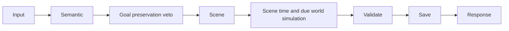

# Turn latency: measured optimization batch

Production save is read-only. Measurements below use historical logs, a temporary copy,
or a newly created isolated test world. No production turn was executed.

## Evidence and priorities

1. Serial model work is the largest complex-turn cost. Trace `tr_1b00b864626f`
   took 140.643 seconds. There are **nine** completed HTTP response bodies, including
   planning, an alignment rejection/replan, binding, a 25.867-second truncated
   generation and recovery, and narration. Counting only `routine.ai.response`
   misses direct calls and unsuccessful generations. Transport completion is not
   proof of schema acceptance. The new trace script lists both sets separately.
2. A normal scene trace `tr_35f4172c1958` took 53.596 seconds, with three serial
   successful model calls (5.075 + 2.122 + 14.214 = 21.411 seconds). Semantic
   interpretation → goal preservation veto → scene generation are dependent.
   The remaining 32.185 seconds include context assembly, state reads, validation,
   snapshots, persistence and final projection; old logs cannot attribute all of
   that remainder to a specific function or to CPU alone.
3. Large saves repeatedly copy, parse and validate historical snapshots. The
   measured isolated save is 28,969,736 characters at revision 272. `worldImage`
   formerly cloned histories/audit first, only to delete them. Disk reads also
   reparsed and revalidated identical bytes every time.

Priority chosen: remove redundant local work with unchanged world semantics.
Deleting semantic vetoes is high risk: they detect lost investigation goals,
wrong operation planes and speech/travel ordering. Model-call consolidation is
still a proposal, not implemented by this batch. Existing direct perception and
bound-map travel paths remain in place; no new keyword classifier was added.

## Implemented

- `worldImage` selects the existing Undo field allowlist **before** cloning.
  Checksum bytes and checkpoint semantics are unchanged.
- `JsonStore` reuses a private validated snapshot only while device, inode, size,
  nanosecond mtime and ctime match. Every returned value is independently cloned.
  Writes invalidate both before and after persistence; external replacement is
  detected. A cache miss still runs full validation, as does every write. There
  is no revision-only cache, speculative action, RNG consumption or new authority.
  At most current/checkpoint snapshots are retained per store instance. This can
  retain roughly one extra parsed save per used slot and still pays cloning cost.
- `save.read` diagnostics report hit/miss and elapsed time without content.
- Reproducible local and historical timing scripts plus a four-call-budget real
  HTTP acceptance script were added. Prompt/secret contents are omitted from the
  trace timing projection.

The complex physical trace instead follows semantic → plan → alignment veto →
replan → alignment → action interpretation → binding (truncated) → compact
recovery → Core → narration/firewall → commit → response. These are actual
dependencies in that trace, not a claim that every action takes that path.

Full regression also exposed a pre-existing continuity change that excluded
perception from `activity` evidence. Eight tests showed observations could commit
time but then fail the completion contract. The fix restores activity evidence
for completed perception, without inventing discoveries or treating physical
contests as ordinary activities. No test assertions were changed.

## Paired local measurements

Seven sequential measurements each, same isolated file and process; nearest-rank
P95 of seven samples is just the maximum, not a population tail estimate.

| Operation | Before P50 / P95 | After P50 / P95 |
| --- | --- | --- |
| Undo world projection | 344 / 419 ms | 14 / 42 ms |
| Repeated disk read | 1108 / 1368 ms | 353 / 760 ms |

The read measurement is warm-cache (7/7 hits); it does not establish a live-session
hit rate. The first read still validates and creates a defensive copy. No model
tokens or calls were added by either optimization. Dollar cost is not measured.
These function-level reductions are **not** a measured 50% turn improvement.

### Complete HTTP cache-only A/B

The same isolated revision-272 snapshot, same input, same deterministic semantic /
audit / scene payloads, alternating arms, three samples per arm. Both arms already
use the optimized Undo projection; the only difference is the storage read cache.
No builds or test suites ran concurrently. Provider latency is **zero by design**.

| Arm | Samples (seconds) | P50 | Sample P95 / max |
| --- | --- | --- | --- |
| Original uncached read | 18.873, 19.050, 18.400 | 18.873 | 19.050 |
| Cached read | 14.376, 13.527, 16.391 | 14.376 | 16.391 |

P50 reduction: 23.8% (4.497 seconds). All six requests completed with three model
fixture calls, one revision increment, unchanged player location and no whole
minute advancement. Each request began from the identical isolated snapshot.
This measures full local HTTP work, **not real Provider turn latency**; three
samples cannot establish production P95. The 13–16 seconds remaining even without
model delay demonstrate that further local context/validation/commit profiling
is still warranted, as well as investigating expensive serial model work.
Report: `.tmp/turn-http-cache-1792102129232/report.json`.

## Real Provider HTTP result

One newly isolated small-world NPC greeting completed via `/api/input`:

- HTTP 200, 12.671 seconds, revision 0 → 1 exactly once.
- Three serial DeepSeek calls: 3.036, 1.857 and 7.453 seconds.
- Input tokens: 6491 + 800 + 5609 = 12900.
- Output tokens: 483 + 199 + 1042 = 1724 (reasoning included in provider output
  accounting; do not add reasoning tokens again).
- No model retry; result is `completed`, `story`, with ordered player/NPC speech.
- The short scene accumulated sub-minute time; displayed minute remained 09:00.
- Report: `.tmp/turn-latency-1792101054092/report.json`.

The first diagnostic HTTP attempt was rejected by the local session-token guard
before any model call. The script was corrected to obtain its own test service
session. This was not a Provider retry or a world action.

This small fixture differs from the historical formal-world scene. It proves
current real HTTP usability, **not** a comparable 53.596 → 12.671-second speedup,
P50/P95 improvement, or quality equivalence across all turn classes.

## Explicit limits

No speculative next-turn LLM call, prompt-prefix cache, new context precomputation
system or streaming narrative was introduced. The validated disk snapshot is the
only new cache. Streaming raw JSON/prose before full firewall validation would
expose rejected facts; splitting authoritative commit and narration requires a
separate recovery design. Existing truthful phases and terminal recovery remain.
First meaningful story feedback in the real sample arrived with the final result;
there is no measured improvement in early story delivery.

Core world-time effects, due routines/incidents, NPC direct reactions and atomic
persistence must still precede a complete result. Optional choice generation was
already nonblocking before this batch. No further mandatory work was deferred.

Representative ordinary/complex paired real-model P50/P95, first-token inference
timing (the provider currently returns nonstreamed JSON), provider-native prefix
cache savings, and a general 50% reduction remain **unverified**. A nine-call
complex chain and provider generation long tails still prevent a universal
10–20-second guarantee. Do not infer a model quality result from local timing.

## Engineering verification

- Targeted observation/recovery/cache/physical regression: 4 files, 50 tests passed.
- Final full suite: **123 files, 1134 tests passed**, single worker, 425.89 seconds.
  This rerun includes the restored perception activity evidence.
- Original sparse-routine tests also passed independently (15 tests); its original
  45-second gate was not increased. No claim is made about a paired improvement
  over the earlier 49.8-second week profile.
- TypeScript and production build passed. Existing bundle-size/Zod annotation
  warnings remain.
- Isolated desktop 1366px and mobile 390px rendering regression passed using
  deterministic HTTP replies. This is not a live-Provider browser timing result.
- Disk-backed HTTP tests verify one MOVE commit, idempotent replay, stale revision
  rejection, restart recovery, and Undo restoring time and location.
- Production `data/current.json` SHA-256 remained
  `4a00df1f1669d1eb9e3091be32d02592b5c8b2d4f1253f2f8974990a2a627bcc`.
